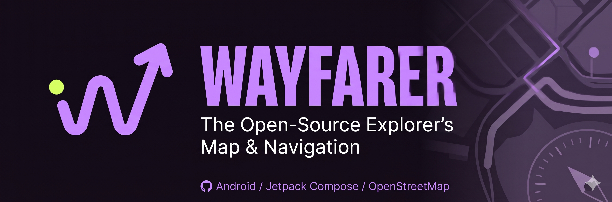

<p align="center">
  
</p>

<div align="center">

[](https://kotlinlang.org/)
[](https://developer.android.com/jetpack/compose)
[](https://github.com/)
[](https://maplibre.org/)
[](LICENSE)

<p align="center">
  <b>Wayfarer</b> is a privacy-focused, high-performance native Android map and turn-by-turn navigation engine built with <b>Jetpack Compose</b>, <b>Material 3 Expressive Design System</b>, and <b>MapLibre Native GL</b>. Powered by <b>OpenStreetMap</b> and <b>OSRM</b>, it delivers real-time vector map rendering, multi-transport route guidance, custom Canvas radial speedometers, and live telemetry.
</p>

---

</div>

> [!NOTE]
> **Privacy-First Architecture**: Zero telemetry tracking or background location uploads. All GPS fixes, route math, and vector map rendering happen 100% locally on your device.

---

## 🌟 Key Highlights

- **Material 3 Expressive Aesthetics**: Obsidian Plum (`#120D18`) & Soft Lilac (`#FAF5FF`) surface tokens, Electric Lavender (`#C699FF`), Acid Lime (`#D8FF72`), & Warm Coral (`#FF9B9B`) semantic pops, 32.dp rounded shapes, and tight-tracked display headers.
- **Custom Google Fonts Typography**: Bundled zero-latency typography featuring **Bricolage Grotesque** for display headers, **Inter** for street names and place cards, and **JetBrains Mono** for tabular numeric telemetry (`tnum`).
- **Live Animated Radial Speedometer**: Interactive `88.dp` floating radial gauge with a `240°` animated arc, color shifting dynamically from Acid Lime to Warm Coral at higher speeds (`> 80%` scale). Supports click-to-toggle compact digital pill mode and Metric (`KM/H`) vs. Imperial (`MPH`) units.
- **Multi-Transport Mode Guidance**: Real-time route calculation and turn-by-turn navigation tailored for **Driving (Car)**, **Walking (Foot)**, and **Cycling (Bike)** with mode-specific travel speeds.
- **Custom Canvas Wavy Progress Scrubber**: Real-time animated sine-wave trip progress scrubber during live navigation (inspired by Android 14/15 Expressive media scrubbers).
- **One-Tap Coordinate Sharing**: Instantly share your live GPS coordinates or any selected place pin (`22.xxxxxx, 88.xxxxxx`) via Android's native Sharesheet with a universal map link.
- **Stacked Overlapping Route Cards**: Expressive stacked route preview cards displaying oversized duration readouts (`44.sp`) and high-contrast pill badges.
- **Adaptive GPS Refresh Controls**: Adjust position update polling from **1 second (High Accuracy)** to **8 seconds (Battery Saver)** via a dedicated M3 slider.

---

## ⚡ Feature Matrix

### 🎨 Material 3 Expressive Design
- High-contrast obsidian plum dark theme & soft lilac light theme.
- High-visibility acid lime (`#D8FF72`) and warm coral (`#FF9B9B`) semantic highlight badges for active routes, speed warnings, ETAs, and CTA buttons.
- Tabular numbers (`tnum`) across all time, distance, speed, and coordinate readouts.

### 🗺️ Vector Maps & Styles
- Powered by **MapLibre GL Native Android SDK** (`v13.7.1`) and **OpenStreetMap**.
- One-tap style switching between **Light** (CARTO Positron), **Dark** (CARTO Dark Matter), and **Libre** vector map tiles.
- Smooth gesture panning, pinch-to-zoom, and automatic route bounding box camera adjustments (`LatLngBounds`).

### 🧭 Navigation & Speed Telemetry
- Multi-step route planning (Select Origin $\rightarrow$ Select Destination $\rightarrow$ Generate Route).
- Supports **Driving (Car)**, **Walking (Foot)**, and **Cycling (Bike)** profiles via the OSRM REST API with realistic mode-specific speed calculations.
- Live navigation state tracking with map-matching, traveled vs. remaining distance, remaining duration, automatic off-route detection, and custom Canvas wavy progress scrubbing.
- Interactive radial speedometer widget with deadband filtering (`< 0.35 m/s`), Exponential Moving Average smoothing (`alpha = 0.35f`), and compact digital pill mode.

### 🔍 Search & Geocoding
- Global geocoding and landmark search powered by OpenStreetMap's **Nominatim API**.
- Floating capsule search pill (`52.dp` height, `CircleShape`, `surfaceContainer` fill) with action buttons.
- Local search history persistence with instant recent search recall and one-tap removal.

### ⚙️ Expressive Settings & Personalization
- Large expressive display header (`40.sp` bold title, circular `44.dp` back button).
- **Theme Mode**: System Default, Light Mode, Dark Mode.
- **Dynamic Color**: Material You wallpaper-matching on Android 12+ (API 31+).
- **Speedometer Settings**: Toggle speed units (`KM/H` vs. `MPH`) and show/hide the floating speedometer in Free Drive mode.
- **GPS Refresh Rate Slider**: Customize hardware position updates between **1s** (maximum responsiveness) and **8s** (battery saving).
- **Accent Color Palettes**: Pick between 6 custom Material 3 color palettes (*Lavender Purple, Emerald Mint, Sunset Coral, Royal Violet, Amber Sand, Cyan Ocean*).

---

## 🛠️ Technology Stack

| Layer | Technology / Library |
| :--- | :--- |
| **Language** | [Kotlin 2.2.10](https://kotlinlang.org/) |
| **UI Framework** | [Jetpack Compose](https://developer.android.com/jetpack/compose) (Material 3 Expressive) |
| **Typography** | [Google Fonts](https://fonts.google.com/) (*Bricolage Grotesque, Inter, JetBrains Mono*) |
| **Map Rendering** | [MapLibre Native Android SDK](https://maplibre.org/) (`v13.7.1`) |
| **Geocoding API** | [OpenStreetMap Nominatim API](https://nominatim.org/) |
| **Routing Engine** | [Open Source Routing Machine (OSRM API)](https://project-osrm.org/) |
| **Networking** | [Retrofit 2](https://square.github.io/retrofit/) + [Gson](https://github.com/google/gson) |
| **Location Services** | [Google Play Services FusedLocationProviderClient](https://developers.google.com/android/reference/com/google/android/gms/location/package-summary) (`v21.4.0`) |
| **Architecture** | Unidirectional Data Flow (UDF) + MVVM + Coroutines & StateFlow |

---

## 🏛️ Architecture

Wayfarer strictly follows modern Android **MVVM (Model-View-ViewModel)** and **Unidirectional Data Flow (UDF)** guidelines with modular stateless UI components:

```
                            ┌───────────────────────────────┐
                            │    MainActivity / App Host    │
                            └───────────────┬───────────────┘
                                            │ AnimatedVisibility
                                            ▼
               ┌────────────────────────────────────────────────────────┐
               │                                                        │
               ▼                                                        ▼
  ┌───────────────────────────┐                            ┌───────────────────────────┐
  │         MapScreen         │                            │      SettingsScreen       │
  │   (State & Event Host)    │                            │   (Jetpack Compose UI)    │
  └─────────────┬─────────────┘                            └─────────────┬─────────────┘
                │                                                        │
                ├───────────────────────┬────────────────────────┐       │
                ▼                       ▼                        ▼       │
   ┌───────────────────────┐ ┌────────────────────┐ ┌──────────────────┐ │
   │     SearchOverlay     │ │ MapControlsOverlay │ │RoutePreviewSheet │ │
   └───────────────────────┘ └────────────────────┘ └──────────────────┘ │
                │                       │                        │       │
                └───────────────────────┼────────────────────────┴───────┘
                                        │ Observes StateFlow<MapState>
                                        ▼
                          ┌───────────────────────────┐
                          │       MapViewModel        │
                          │    (UDF State Holder)     │
                          └──────┬─────────────┬──────┘
                                 │             │
          ┌──────────────────────┘             └──────────────────────┐
          ▼                                                           ▼
┌──────────────────┐                                     ┌──────────────────────────┐
│  LocationClient  │                                     │UserPreferencesRepository │
│ (Fused Location) │                                     │  & GeocodingRepository   │
└──────────────────┘                                     └──────────────────────────┘
```

- **`MapState`**: Single source of truth containing camera position, user location, speed telemetry, search state, active route, transport mode, settings, and developer logs.
- **`MapViewModel`**: Exposes immutable `StateFlow<MapState>`, manages location subscriptions, applies speed deadband/EMA smoothing, and handles route calculations and user preference persistence.
- **`UserPreferencesRepository`**: Persists theme modes, color palettes, dynamic colors, speed units, speedometer toggles, and GPS update intervals to disk using `SharedPreferences`.
- **`DefaultLocationClient`**: Reactive `callbackFlow` wrapper around `FusedLocationProviderClient` supporting dynamic update interval changes.

---

## 🚀 Getting Started

### Prerequisites

- **Android Studio**: Ladybug / Jellyfish (2024.1+) or newer.
- **JDK**: Java 11 or higher.
- **Android Device / Emulator**:
  - `compileSdk`: 37
  - `minSdk`: 26 (Android 8.0 Oreo+)
  - `targetSdk`: 37

### Build & Run Instructions

1. **Clone the Repository**:
   ```bash
   git clone https://github.com/adityapaul/Wayfarer.git
   cd Wayfarer
   ```

2. **Open in Android Studio**:
   Launch Android Studio, select **Open**, and choose the `Wayfarer` directory. Allow Gradle sync to complete.

3. **Compile Debug APK**:
   ```bash
   ./gradlew assembleDebug
   ```

4. **Execute Unit Test Suite**:
   ```bash
   ./gradlew testDebugUnitTest
   ```

---

## 🧪 Testing

Wayfarer includes a comprehensive unit test suite (`MapViewModelTest.kt`) verifying core business logic:
- Initial state & speedometer configuration verification
- Route planning transitions and OSRM route calculations
- Mode-specific speed and duration calculations (`Drive`, `Walk`, `Cycle`)
- Origin & destination swapping, clearing, and error handling
- Adaptive GPS refresh rate updates and value clamping (1s–8s)
- Speedometer unit conversion (`KM/H` vs `MPH`) & preference persistence
- Search query submission and geocoding response parsing
- Camera recentering and map style cycling
- Settings navigation state management

---

## 📜 Attributions & Acknowledgments

- **Map Data**: © [OpenStreetMap](https://www.openstreetmap.org/copyright) contributors.
- **Vector Tile Services**: © [CARTO](https://carto.com/) & [MapLibre](https://maplibre.org/).
- **Routing Engine**: [Open Source Routing Machine (OSRM)](https://project-osrm.org/).
- **Geocoding Engine**: [Nominatim API](https://nominatim.org/).
- **Typography**: [Google Fonts](https://fonts.google.com/) (*Bricolage Grotesque, Inter, JetBrains Mono*).
